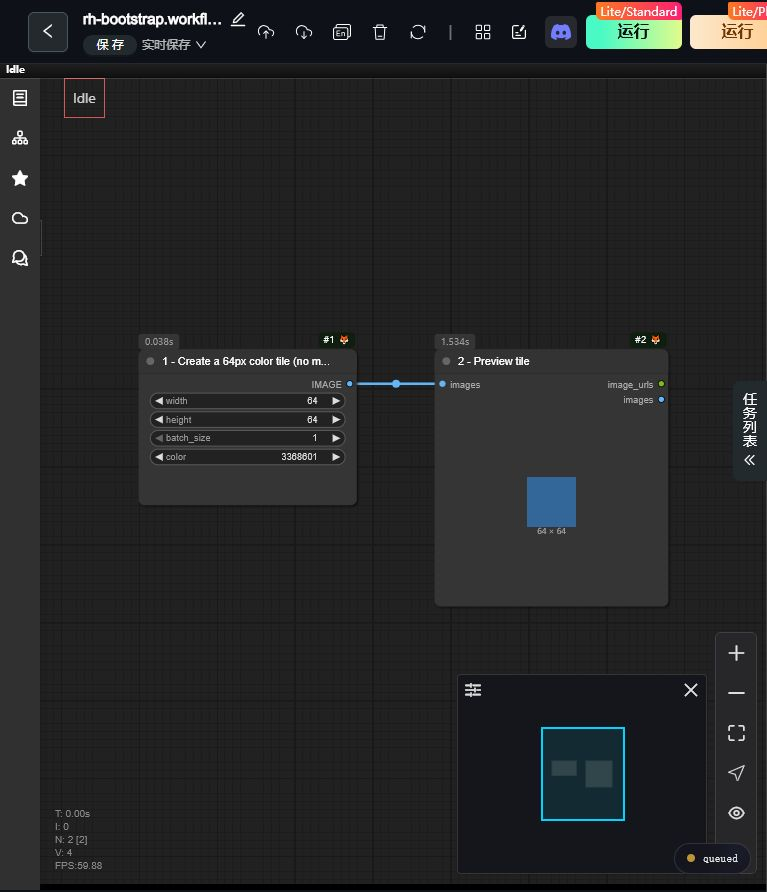

# RH工作流API接入：导入最小模板并初始化一次

本步骤属于RH接入层。独立制作、商品宣传和RH超分共用同一套接入编号；不要选了商品流程才突然索取。已有已核验编号直接复用，已有成功运行过的工作流也可只读核验，不必重建。

## 首次操作：给文件、给截图、给步骤

逐步展示[红框操作图](visual-setup.md)，包括官网网址、导入按钮、改名铅笔、保存、Lite运行与地址栏复制。Agent在需要用户手动操作时显示对应图片，不只丢文档链接。

直接把[可导入文件 rh-bootstrap.workflow.json](bootstrap/rh-bootstrap.workflow.json)的本机绝对路径作为可点击文件发给用户，不让用户自己复制JSON。跨系统从当前Skill安装目录解析文件路径，不写死作者盘符。该文件仅有两个节点：EmptyImage创建64×64色块，PreviewImage显示色块；不含H3、任何模型Loader、采样器、商业API或外部素材。

向用户简短说明：“RH的工作流API需要一个已经保存并在网页运行过的工作流编号。这份最小模板只生成小色块用于完成这一步，不需要你搭视频节点；以后实际制作内容由我通过API提交。”

1. 打开[RunningHub国际站工作台](https://www.runninghub.ai/zh-cn/workspace)，登录Key对应账号。
2. 点击下图‘工作流’区域右侧的**导入工作流**，选择提供的`rh-bootstrap.workflow.json`。导入方式随页面版本变化时以实际控件为准，不改成要求用户手工搭图。
3. 打开导入的流程，应能看到“创建64px色块→预览”两个相连节点。点击左上名称旁的铅笔改为`AI Video Studio`，再点左上“保存”。
4. 在网页**手动运行一次**，看到色块预览后等待任务结束，再保存。此步可能产生RH平台最低算力费用，不承诺零扣费；只运行这份最小模板一次，不使用模型生成做接入测试，不重复抽测。
5. 把编辑页完整网址发给Agent。Agent提取编号，做只读API核验并保存到这套接入。以后不重复索取。


标注图基于真实截图制作；复制网址图的地址栏是明确标识的示意。实际运行证据见文末原始截图。Agent若有浏览器能力且用户授权，可代做导入/保存等操作，并根据实际页面给出新截图。没有浏览器能力仍可通过上述文件完成引导。不得因截图按钮位置变动伪称已经点击或运行。

## 为什么不能保留空白

RH官方对810 `WORKFLOW_NOT_SAVED_OR_NOT_RUNNING`的说明是：在平台保存并手动运行一次。空画布没有可执行输出，不能作为可靠的初始化方法。不要再指示“保持空白、无需运行”，不要收到810后反复只让用户保存或刷新。

官方依据：[错误码810](https://www.runninghub.cn/runninghub-api-doc-en/doc-8287467)。文档域名与实际执行站点分开，当前工具仍只支持国际站。

## Agent保存与恢复

```text
rh --account CONFIG_NAME --credential member execution-entry --workflow-id WORKFLOW_URL_OR_ID
rh setup-status --account CONFIG_NAME
```

execution-entry只调用`/api/openapi/getJsonApiFormat`，不启动算力。成功才保存`AIVideoStudio/integrations/runninghub.json`的`accounts.<配置名>.execution_entry`，包含workflow_id、credential、verified、checked_at；旧profile模式保存在对应profile。配置按账号隔离，并绑定核验凭据，换凭据重新核验。

收到810：停止同一前提下的重复核验，直接给最小文件、上述截图和一次运行步骤。用户确认已运行或页面确有完成证据后，再只读核验。仍失败就保留原错误检查执行结果，不诱导重复收费运行、不偷偷保存为已验证。任何自动运行都需要用户对该初始化操作的授权，并遵守预算限制；本包不自动提交bootstrap任务。

submit不传--workflow-id时自动读取已保存编号；有原task回执先恢复原任务。读取通过仅证明API能访问该工作流，不冒充H3推理已成功。不得把历史私人ID做成通用默认值，也不覆盖原工作流网页内容。实际运行由本次完整JSON决定。

## 本包验证范围

2026-10-20已在内置浏览器完成实际验证：从工作台导入本包JSON，出现新流程条目；打开后保存，点击Lite/Standard运行一次，预览节点显示64×64蓝色色块；原任务状态API返回SUCCESS，getJsonApiFormat成功读回EmptyImage与PreviewImage。入口经只读核验保存后可供同一接入后续提交使用。此次验证仅证明初始化流程与读取，不等于额外验证H3生成。平台outputs对PreviewImage返回空列表，未返回consumeCoins；不据此声称费用为零，也不按钱包差额估算。实际账号、工作流ID和任务ID只保留本机验证记录，不写入共享默认配置。



普通用户不需知道后端节点参数。API格式graph.json仅供内部核对，给用户的是rh-bootstrap.workflow.json。文件选择器返回异常或结果不明时，先查看工作台是否已有新条目，不能直接重复导入、重复运行。
