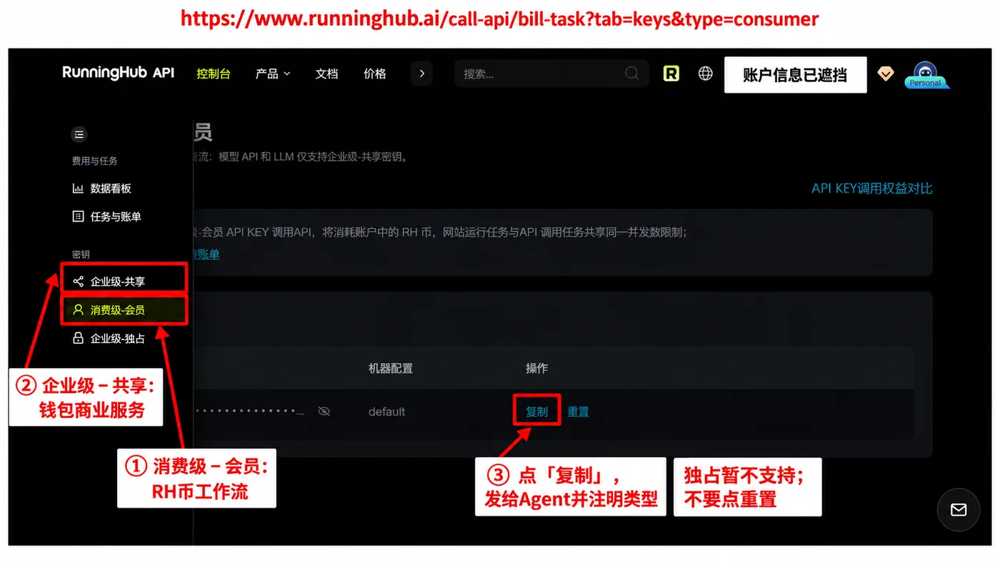
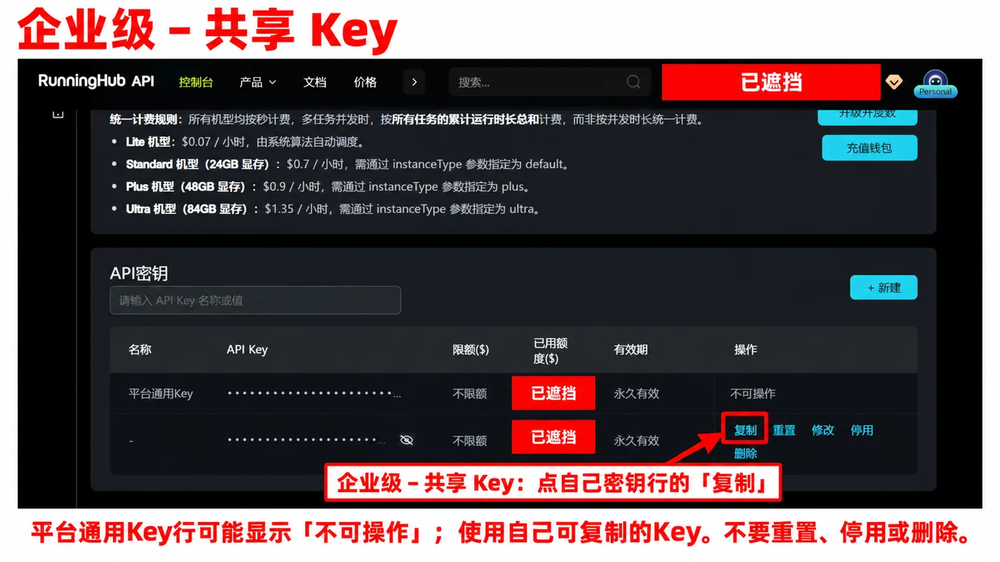
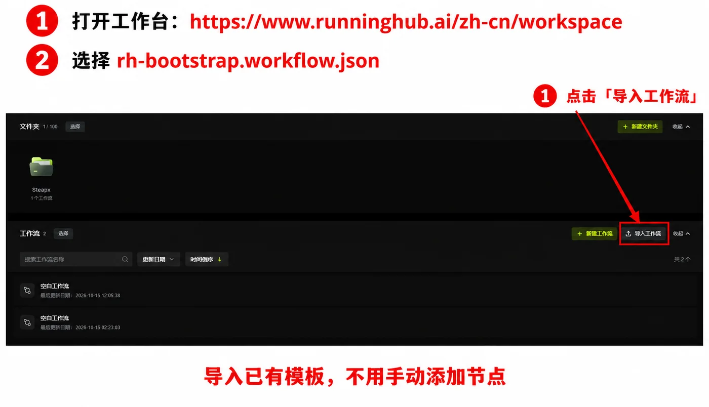
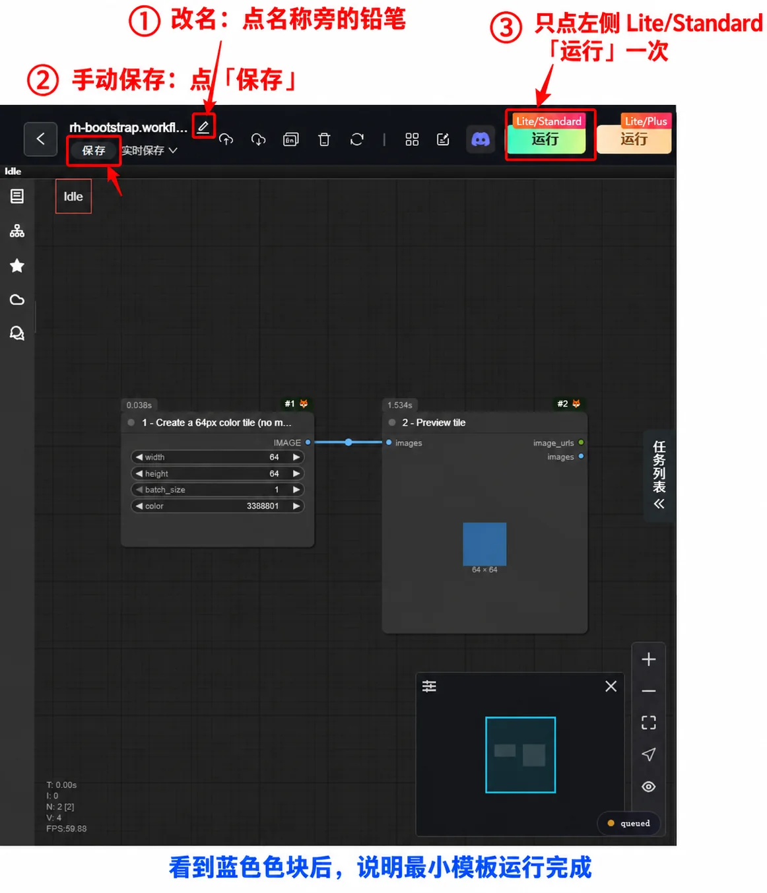
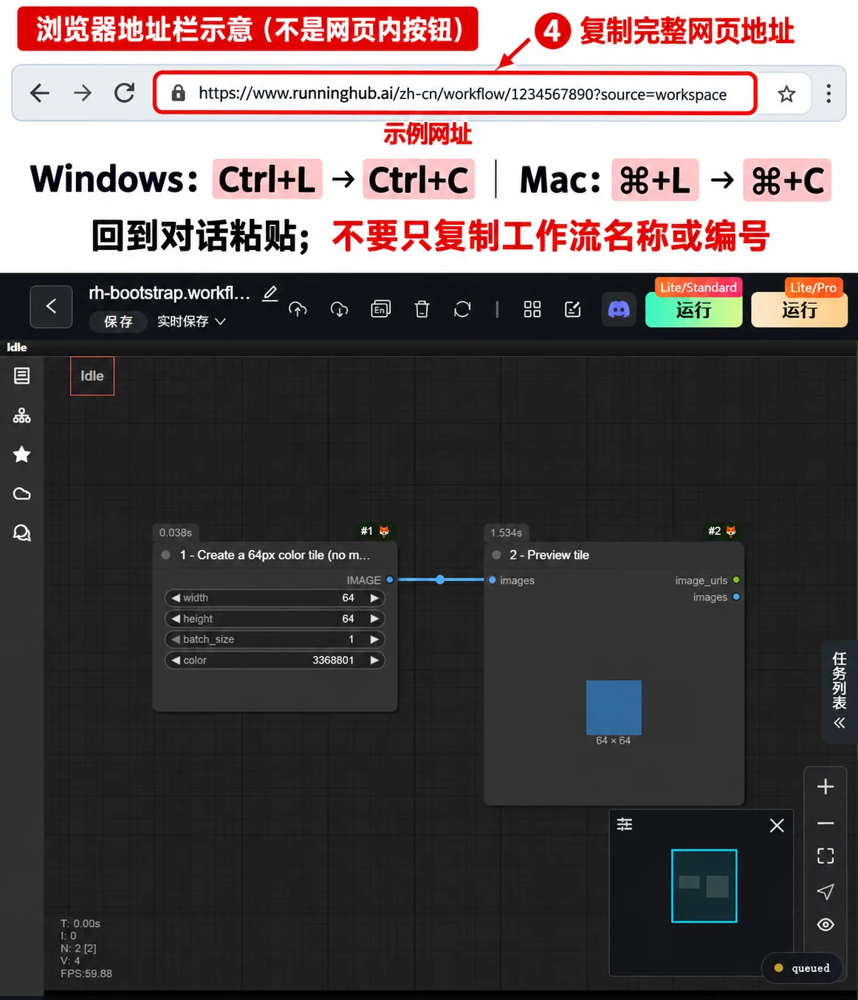

# RunningHub接入操作图

这些是基于真实网页截图制作的红框标注图；网址复制图上方的地址栏明确为示意，不是RH网页按钮。按钮名称随版本变化时以实际页面为准。图片已经压缩，可直接显示给用户，不需要用户具备生图或图片编辑能力。

## 1. 获取两种API Key

打开[国际站Key管理页](https://www.runninghub.ai/call-api/bill-task?tab=keys&type=consumer)。侧栏折叠时先展开菜单。

- 选**消费级－会员**，点密钥行的**复制**，在对话里注明“消费级－会员”。用于会员权益和RH币工作流。
- 再选**企业级－共享**，点自己密钥行的**复制**，注明“企业级－共享”。用于钱包计费的商业服务及相应工作流。
- 建议同一账号两种一起提供；企业级－独占目前不支持执行。不要点“重置”、停用或删除，也不用点眼睛显示Key。

共享页可能需要向下滚动到自己的密钥行。“平台通用Key”行可能不可操作；应复制自己可复制的Key。

配置英文名称、Key保存和只读鉴权由Agent按[Key指引](key-setup.md)处理。截图里的密钥与账户金额已遮挡；不是要用户把Key遮住后才发给Agent。

## 2. 打开工作台并导入文件

打开[国际站工作台](https://www.runninghub.ai/zh-cn/workspace)。在“工作流”区域点右侧**导入工作流**，选择Agent提供的[rh-bootstrap.workflow.json](bootstrap/rh-bootstrap.workflow.json)。无需先新建空白流程，无需手工加节点。

导入后，在列表找到`rh-bootstrap.workflow`，单击打开。Agent提供文件时使用当前安装目录下的真实绝对路径，不让用户从本文相对路径推算本机位置。

## 3. 改名、手动保存、运行一次

按下图编号操作：

1. 点左上角工作流名称旁的**铅笔图标**，输入`AI Video Studio`并确认。只是改这份网页流程名称，不是修改RH账号名称。
2. 点左上角**保存**；即使启用了实时保存，也可手动保存确认。
3. 点靠左的绿色**Lite/Standard 运行**，只运行一次。不要误点右侧Lite/Plus或Ultra；该最小模板只做64px色块，不需要大模型。可能产生平台最低算力费，不承诺免费。

等到蓝色色块预览出现并且任务结束，再点一次保存。Agent应检查原任务状态，不以旧预览或小角落的queued字样独自判断新任务完成；不重复运行。

## 4. 从浏览器地址栏复制网址

复制**当前工作流编辑页顶部浏览器地址栏**里的完整网址，不是网页左上角的工作流名称，也不是文件名。图中的数字是示例，不要把示例网址发给Agent。

- Windows浏览器：`Ctrl+L`选中地址，再`Ctrl+C`复制。
- Mac浏览器：`⌘+L`，再`⌘+C`。
- 内置浏览器若不支持上述快捷键，直接点其顶部地址栏，选择完整网址后复制；不要在工作流画布里找“复制网址”按钮。
- 回到对话粘贴即可。Agent提取真实ID、只读核验并保存到对应接入配置。

## Agent展示原则

接入时先给可点击官网网址，再显示当前步骤的标注图，配两三句动作说明。需要手动操作时主动展示对应图片，不能只说“见文档”；不要一次把所有长图和技术说明都堆给用户。Key完成后再展示导入/保存/运行/复制网址步骤。已有信息和已验证入口直接复用，不要求重复操作。API核验、810处理和配置保存仍按[执行入口规则](execution-entry.md)。
